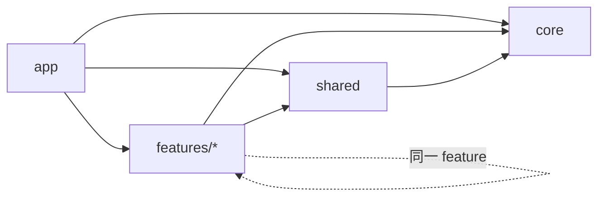

# 架构说明

本文描述仓库当前的真实结构与边界，不是目标态清单。历史设计记录在
`docs/superpowers/`，保持原样，不作为当前规范。

## 顶层目录

| 路径 | 职责 |
| --- | --- |
| `godot/` | 主游戏，Godot 4 工程 |
| `prototypes/web/` | 早期 Web 原型（React + Vite + three.js），根 `package.json` 的 npm workspace，仅作参考 |
| `art_source/` | 原始素材、历史备份与参考包，不参与运行打包 |
| `scripts/` | 架构检查、Godot 检查与兼容入口 |
| `docs/` | 架构、结构与历史设计文档 |
| `architecture.config.json` | 架构检查的项目级例外（行数预算、跨 feature 白名单等） |
| `package.json` | npm workspace 根；`npm run check` 是完整质量入口 |

## Godot 目录与职责

| 路径 | 职责 |
| --- | --- |
| `godot/app/` | 组合根与跨 feature 编排：`game.gd`、`scene_router.gd`、`battle_flow.gd`、`save_coordinator.gd`；`game.tscn` 是默认主场景 |
| `godot/core/` | 规则、数值、状态、数据读取与存档；不得依赖场景/UI 类型 |
| `godot/core/tactics/` | 战棋基础规则：网格、朝向、行动序、模式、地图读取、数值规则 |
| `godot/features/` | 按功能划分的场景、控制器与专属辅助 |
| `godot/shared/` | 跨 feature 复用的资源、场景搭建、玩法、音频与 UI 组件 |
| `godot/data/` | 内容 JSON：玩家、武学、敌人、遭遇、物品、任务、境界、熟练度、城镇/酒馆/森林、说话人、`dialogues/`、`sprites/`、`maps/` |
| `godot/assets/` | 运行时原始素材与工具输入；说明见 [assets/README.md](../godot/assets/README.md) |
| `godot/tools/` | 离线生成、调参、模拟与冒烟测试 |
| `godot/tests/` | 自动测试，`run_tests.gd` 自动发现 `test_*.gd` |

### features 细分

| 目录 | 主要内容 |
| --- | --- |
| `features/battle/` | `battle_view`（界面壳）、`battle_session`（战斗会话）、`battle_stage`、`battle_hud`、`battle_action_bar`、`battle_enemy_heads`、`battle_effects`、`battle_dialogue_flow`、`battle_text`、`skill_slot` |
| `features/character/` | `character_panel`（外壳、页签切换、左栏与淡入）、`character_attributes_tab`、`character_skills_tab`、`character_equipment_tab`、`character_points_tab`（页签内容与常驻状态）、`character_panel_data`（属性/武学数据读取）、`character_panel_style`（页签共用控件样式）、`status_overlay`（角色/任务面板与 toast） |
| `features/forest/` | `forest` 控制器、`forest_patrol`、`forest_alert`、`forest_pickups` |
| `features/pause/` | `pause_menu`（存档、读档、设置、返回标题、退出） |
| `features/tavern/` | `tavern` 控制器、`tavern_npc_roster`、`tavern_story_director`、`tavern_prefight_show`、`tavern_furniture_system`、`tavern_state_animation` |
| `features/title/` | `title_screen`（标题/读档/设置）、`title_cinematic`（分镜背景） |
| `features/town/` | `town` 控制器与 `town.tscn` |

`features/tactics/` 目前还不存在；它是新战棋界面的落点，不要把战棋 UI 塞进现有场景控制器。

### shared 细分

| 目录 | 主要内容 |
| --- | --- |
| `shared/audio/` | `audio_manager`、`audio_loader`（直接解析 WAV 字节） |
| `shared/gameplay/` | `player_motion`、`interaction`、`stealth`、`pickups` |
| `shared/resources/` | `asset_paths`、`ai_assets`、`image_cache`、`sprite_sheet`、`town_data`、`forest_layout` |
| `shared/scene/` | `scene_kit`、`texgen`、`character_sprite`、`world_camera` |
| `shared/scenery/` | 小镇/酒馆/森林的搭建与视觉辅助，含 `backdrop_factory`、各场景 `*_backdrop_scene` |
| `shared/ui/` | HUD 样式与基础组件、对话视图、图标映射、装饰面板、共享音频设置面板（`audio_settings_panel`） |

## 依赖方向

箭头表示静态导入方向。跨功能的运行时信号由 `app` 连接，不产生 feature 对 app 的反向导入。

规则由 `scripts/architecture/` 执行：

- `app` 可以 import `app`、`core`、`features`、`shared`。
- `core` 只能 import `core`。
- `shared` 只能 import `shared`、`core`；不能 import `features`。
- `features/<x>` 可以 import 同一 feature、`core`、`shared`。
- 跨 feature 直接 import 默认违规。需要例外时在 `architecture.config.json` 登记精确条目并写 reason；
  常规做法是把编排放到 `app/`，或通过信号/明确事件协作。
- 生产脚本和场景不能再放回 `godot/ui/`、`godot/world/`；这两个旧根目录已废弃。

## 控制器与状态归属

| 入口 | 自己持有/负责 | 已拆出的模块 |
| --- | --- | --- |
| `app/game.gd` | 组合根：overlay、audio、pause menu 的引用，toast 音效去重；对测试和旧调用点保留 facade 字段 | 场景路由 → `scene_router`；存档/自动存档/游玩时长 → `save_coordinator`；战斗进出 → `battle_flow` |
| `app/scene_router.gd` | `current`、`current_kind`；场景创建、卸载、路由和每类场景的音乐/环境音/自动存档表现 | 各 feature 场景 |
| `app/save_coordinator.gd` | `save_dir`、`profile_path`、`loading_slot`、自动存档/档案轮询计时器；存档策略与位置格式 | 落盘 → `core/save_system.gd`；持久状态 → `core/game_state.gd` |
| `app/battle_flow.gd` | 当前战斗的敌人/数量/来源、Boss 判定、战后返回场景与任务/flag 更新 | 战斗界面 → `features/battle/*` |
| `features/town/town.gd` | 城镇控制器：玩家与位置、NPC 对话流程、交互、遭遇请求、拾取物 | 数据/名册 → `shared/resources/town_data.gd`；场景搭建 → `shared/scenery/town/*` |
| `features/tavern/tavern.gd` | 酒馆控制器：玩家、房间、交互、当前 NPC、前戏/剧情状态入口 | 家具 → `tavern_furniture_system`；NPC → `tavern_npc_roster`；前戏 → `tavern_prefight_show`；剧情 → `tavern_story_director`；状态动画 → `tavern_state_animation` |
| `features/forest/forest.gd` | 森林控制器：玩家与位置、对话、交互、遭遇请求 | 布局 → `shared/resources/forest_layout.gd`；视觉 → `shared/scenery/forest/*`；巡逻/警戒/拾取 → `features/forest/*` |
| `features/battle/battle_view.gd` | 战斗界面壳与对测试/旧调用点的字段转发 | 战斗会话与持久结算 → `battle_session`；HUD/动作条/敌人头像/特效/对话/舞台各自独立 |
| `features/character/character_panel.gd` | 角色面板外壳：整体遮罩、页签切换与淡入、左栏、对外 `refresh()`/`select_tab()`/`advance()` 与 `tab_index`、`pending_points` 兼容字段 | 四页签内容与常驻状态（含未提交加点、选中武学）→ `character_attributes_tab`、`character_skills_tab`、`character_equipment_tab`、`character_points_tab`；数据/样式 → `character_panel_data`、`character_panel_style` |
| `features/character/status_overlay.gd` | 角色/任务面板开关与 toast | 角色面板 → `character_panel` |
| `features/pause/pause_menu.gd` | 暂停菜单、存读档页 | 设置页 → `shared/ui/audio_settings_panel`；存档读写 → `core/save_system.gd` |
| `features/title/title_screen.gd` | 标题页、存档槽与信号 | 设置页 → `shared/ui/audio_settings_panel`；3D 分镜 → `title_cinematic` |
| `core/game_state.gd` | 全局持久状态：flags、背包、装备、任务、境界、熟练度、游玩时长等，`to_dict()` / `from_dict()` | 文件落盘 → `save_system` |

原则：状态属于真正使用它的模块。控制器只编排和转发信号，不把控制器当作所有状态的万能 host。

## 数据、素材与测试

- 数据加载入口：`core/data_loader.gd` 集中常用 JSON 路径和解析；内容 JSON 只放内容，不放逻辑。
- 运行素材路径入口：`shared/resources/asset_paths.gd`（`AI_GAME`、`SPRITES`、`PORTRAITS`、`AUDIO`）。
  `shared/resources/ai_assets.gd` 读 `ai/game/`，`shared/resources/image_cache.gd` 读立绘/图集，
  `shared/audio/audio_loader.gd` 读 WAV，`shared/ui/icon_lib.gd` 映射界面图标。
- 运行素材没有经过 Godot 导入，现有代码用 `Image.load_from_file` / `FileAccess` 直接读原始文件；
  不要擅自改成 `load()` / `preload()`。
- 地图：`core/tactics/map_loader.gd` 从 `data/maps/<id>.json` 读取宽高、`tiles`、`heights`、`spawns` 等字段。
- 测试：新增 `godot/tests/test_*.gd`，继承 `res://tests/test_case.gd`，提供 `test_*` 方法；
  `run_tests.gd` 自动发现并汇总 `PASS n / FAIL n`。

## 常见改动步骤

### 新增功能

1. 先判断职责：规则/数值进 `core/`，单一玩法或界面进 `features/<name>/`，复用件进 `shared/`，跨 feature 编排进 `app/`。
2. 不改旧根目录；不把新逻辑堆进现有大文件的 `_ready()` / 构建函数。
3. 为行为变化补测试，至少跑受影响的检查。
4. 最终运行 `npm run check`。

### 新增地图

1. 在 `godot/data/maps/<id>.json` 新建地图数据，字段参考 `tavern_brawl.json` / `forest_clearing.json`。
2. 用 `core/tactics/map_loader.gd` 的 `load_map()` / `parse_map()` 读取；校验错误要向上返回，不要静默。
3. 战棋规则放 `core/tactics/`，界面放 `features/tactics/`，地图数据放 `data/maps/`。
4. 在 `godot/tests/` 增加地图解析/规则测试。

### 新增素材

1. 运行素材放 `godot/assets/` 的对应目录：`ai/game/`、`sprites/`、`portraits/`、`audio/`。
2. 文件名用 snake_case；路径优先收敛到 `shared/resources/asset_paths.gd`。
3. 图标遵循 `shared/ui/icon_lib.gd` 的命名与 `ITEM_FILES` 映射；角色图集/立绘经 `image_cache`。
4. 不改 `godot/assets/ai/raw_user/`、`npc_six_preview.jpg` 等工具输入的位置；改名/移动前按
   [assets/README.md](../godot/assets/README.md) 检查动态加载、JSON、工具和测试。
5. 涉及存在性/读取的素材，补 `godot/tests/` 中的测试。

### 新增测试

1. 在 `godot/tests/` 建 `test_<topic>.gd`，`extends "res://tests/test_case.gd"`。
2. 方法名以 `test_` 开头；用 `assert_eq` / `assert_true` / `assert_near` 记录失败。
3. 跑 `npm run check:godot`；没有发现测试或汇总行缺失也会判失败。

## 检查命令

| 命令 | 内容 |
| --- | --- |
| `npm run check` | `test:architecture` → `check:architecture` → `check:godot` → `build` |
| `npm run test:architecture` | 架构检查器自身的 Node 单测 |
| `npm run check:architecture` | Godot 目录/依赖方向/行数预算/资源存在性 |
| `npm run check:godot` | 单元测试、小镇/酒馆/森林场景、默认主场景、冒烟测试 |
| `npm run build` | 转发到 `prototypes/web` 的 Vite 构建 |
| `bash scripts/check.sh` | 兼容薄入口：架构检查 + Godot 检查 |

Godot 引擎优先取 `GODOT_BIN`；未设置时尝试本机默认路径和 PATH 中的 `godot4` / `godot`。
检查脚本只终止自己 spawn 的进程树，不按进程名结束其他 Godot 实例。

## 已知技术债与静态检查边界

### 仍偏大的文件

以下为 `architecture.config.json` 当前登记的精确行数预算。检查要求实际行数不高于预算；
低于预算也会报 `stale-line-budget`，因此拆分后必须下调或删除条目。

| 文件 | 预算（行） |
| --- | ---: |
| `godot/app/game.gd` | 349 |
| `godot/core/battle.gd` | 533 |
| `godot/features/character/status_overlay.gd` | 578 |
| `godot/features/pause/pause_menu.gd` | 663 |
| `godot/features/tavern/tavern.gd` | 597 |
| `godot/features/title/title_screen.gd` | 876 |
| `godot/features/town/town.gd` | 575 |

`pause_menu.gd`、`title_screen.gd` 等仍有后续拆分空间，当前预算已锁定。
角色面板的四页签已拆成独立模块，控制器回到默认 500 行预算内，不再保留特例预算。
地图、战斗与应用入口的多职责拆分已落地；保留的控制器负责输入、生命周期与编排，兼容门面用于已有调用点。

当前 `architecture.config.json` 中没有任何跨 feature 白名单、legacy 跨 feature 边或缺失资源许可
（三项计数均为 0）。

### core 不是完全纯计算

`core/` 的静态检查只禁止场景/UI 基类，并不保证纯函数：

- `core/save_system.gd` 直接做 `FileAccess` / `DirAccess` 文件 IO、原子替换和 `Time`/`ProjectSettings` 调用。
- `core/data_loader.gd` 通过 `FileAccess` 读 JSON。
- `core/game_state.gd` 持有进程级可变的 static 状态。
- `core/progression.gd`、`core/realms.gd`、`core/mastery.gd` 等持有 static 缓存/配置。
- `core/quests.gd`、`core/quest_flow.gd`、`core/progression.gd` 等会经由 `GameState` 读写任务/角色状态。

因此当前真实边界是“不依赖场景/UI 类型”，而不是“无副作用”。涉及这些模块时按有状态代码对待。

### 架构检查的静态限制

- 只解析字符串字面量里的 `res://`；动态拼接的路径无法证明存在，例如
  `"icon_martial_" + id + ".png"`、`"slot_%s.json"`、`"%s/%s.json" % [MAPS_DIR, id]`。
- `load(variable)` / 运行时按名字加载不会被解析；`preload("res://...")` 的字面量会检查。
- 资源存在性只覆盖 `project.godot` 主场景、GDScript 字符串、内容 JSON 行、`.tscn` 的 `ext_resource`；
  不校验素材导入设置、音频可解析性、图片可读性或 UI 布局。
- 场景只检查根节点脚本与场景同目录，不检查所有子节点脚本的相邻关系。
- `core` 的纯净性只按基类黑名单判断；`FileAccess`、`DirAccess`、`Time`、`ProjectSettings` 等不会报错。
- Web 原型没有自动测试；`npm run check` 里只有 Vite 构建这一层验证。
- 历史文档 `docs/superpowers/` 未随代码更新，只作历史记录。
