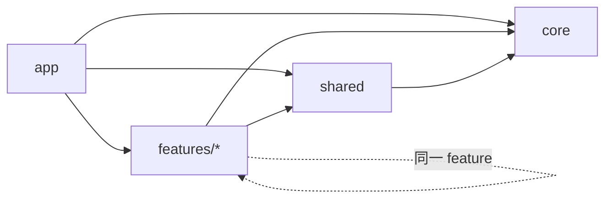

# 项目结构与放置规范

主游戏在 `godot/`（早期 Web 原型已移除，git 标签 `web-prototype-final` 可取回）。运行素材在
`godot/assets/`；原始包、生成工具输入和历史备份在 `art_source/`。详见素材说明。完整架构、状态归属和技术债见 [architecture.md](architecture.md)。

相关文档：[架构说明](architecture.md) · [运行素材说明](../godot/assets/README.md) · [原始素材归档](../art_source/README.md)

## 顶层目录

| 目录 | 职责 |
| --- | --- |
| `godot/` | 主游戏，Godot 4 工程 |
| `art_source/` | 原始素材、历史备份与参考包，不参与运行打包 |
| `scripts/` | 架构检查、Godot 检查与兼容入口 |
| `docs/` | 架构、结构与历史设计文档 |
| `architecture.config.json` | 架构检查的项目级例外 |
| `package.json` | `npm run check` 入口 |

## Godot 模块职责

| 目录 | 职责 | 主要内容 |
| --- | --- | --- |
| `godot/app/` | 组合根与跨 feature 编排 | `game.gd`、`scene_router.gd`、`battle_flow.gd`、`save_coordinator.gd`；`game.tscn` 是默认主场景 |
| `godot/core/` | 规则、状态与数据服务 | 战斗、伤害、招式克制、境界、属性、熟练度、任务、存档、前戏、模拟支持；`data_loader.gd` 是数据入口 |
| `godot/core/tactics/` | 战棋规则 | 基础层 `grid/facing/turn_queue/pattern/stats_rules/map_loader`；结算层 `tactics_battle/reaction/damage/unit/rules/setup`；`tactics_ai`、`tactics_bot` |
| `godot/features/` | 按功能划分的场景与界面 | `battle/`、`character/`、`forest/`、`pause/`、`tactics/`、`tavern/`、`title/`、`town/` |
| `godot/shared/` | 跨 feature 复用件 | 资源入口、场景辅助、玩法、音频、HUD/图标/装饰组件，以及小镇/酒馆/森林的搭建辅助 |
| `godot/data/` | 游戏内容 | 玩家、武学、敌人、遭遇、物品、成长、境界、熟练度、任务、说话人、城镇/森林/酒馆配置、战棋遭遇地图映射；`dialogues/` 对话，`sprites/` 角色配色定义，`maps/` 战棋地图 |
| `godot/assets/` | 运行素材 | `scenery/`、`textures/`、`icons/`、`sprites/`、`portraits/`、`audio/`，读取约定见素材说明 |
| `godot/tools/` | 离线生成与调试 | 像素化、角色图集、立绘、图标、音乐生成脚本；数值模拟、Boss/酒馆调参、难度报告、冒烟测试 |
| `godot/tests/` | 自动测试 | `run_tests.gd` 自动发现并执行 `test_*.gd` |

## 模块图

箭头表示静态导入方向；跨功能信号由 `app` 连接，不表示允许反向导入。

`data/`、`assets/`、`tools/`、`tests/` 不参与生产脚本的依赖方向检查。

## 共享入口

当前共享入口，新代码优先复用：

- `godot/shared/resources/asset_paths.gd`：运行素材目录常量 `SCENERY`、`TEXTURES`、`ICONS`、`SPRITES`、`PORTRAITS`、`AUDIO`，分类函数 `art_dir()` 和 `sprite_path()`。角色图集、立绘、音频和场景/材质/图标素材的路径从这里取；JSON 里已有的显式立绘完整路径（如 `data/speakers.json`）属于内容数据，继续保留。
- `godot/core/data_loader.gd`：顶部集中常用 JSON 的 `*_PATH` 常量，并提供武学/敌人/玩家/物品的读取与校验。新增通用数据路径放这里；与某份内容 JSON 绑定的对话路径可以继续写在内容文件里。
- `godot/shared/scene/scene_kit.gd`：小镇、酒馆、森林共用的网格、材质、灯光和暗角搭建函数。多场景重复的 3D 搭建逻辑应进这里，而不是各自复制。
- `godot/shared/resources/ai_assets.gd` / `image_cache.gd`：前者按文件名前缀读取 `scenery/`、`textures/`、`icons/`，后者读取立绘/图集，两者都用 `Image.load_from_file` 并做纹理缓存。
- `godot/shared/audio/audio_loader.gd`：用 `FileAccess` 解析 WAV 字节，不经过 Godot 导入。
- `godot/shared/ui/icon_lib.gd`：武学/物品/属性图标的统一映射与缓存入口。

## 放置规则

1. 纯规则、状态、数值计算放 `godot/core/`，不依赖 `Control`、`Node3D` 等界面/场景类型。
2. 内容数据、对话、任务配置放 `godot/data/`，不要把内容写死在脚本里；战棋地图放 `data/maps/`。
3. 只属于某张地图或某个功能的逻辑留在对应的 `godot/features/<name>/`，不要放回已废弃的 `godot/world/`。
4. 多地图共用的搭建辅助放 `godot/shared/scenery/`；多界面共用的小组件放 `godot/shared/ui/`。
5. 新功能按职责新建脚本或数据文件；控制器只做编排，避免继续往巨型场景的 `_ready()` / 构建函数里堆代码。
6. 新战棋规则放 `core/tactics/`，战棋界面放 `features/tactics/`，地图数据放 `data/maps/`。
7. 离线生成、调试、模拟放 `godot/tools/`；自动测试放 `godot/tests/`，文件名以 `test_` 开头。

## 已知遗留

- `features/character/character_panel.gd`、`features/pause/pause_menu.gd`、`features/title/title_screen.gd` 等仍是大型模块；
  地图、战斗与应用入口已按职责拆分，控制器保留必要的编排和兼容接口。
  行数预算与详细说明见 [架构说明](architecture.md#仍偏大的文件)。
- `core/` 的检查边界是“不依赖场景/UI 类型”，并不保证纯函数：`save_system.gd`、`data_loader.gd` 有文件 IO，
  `game_state.gd` 等持有 static 状态。
- 并非所有路径都已收口：角色图标按 `icon_*` 规则动态拼接、地图按 `data/maps/<id>.json` 动态读取，
  改路径时仍需按调用点逐一确认，不能只靠 Grep 文件名。
- 运行素材按原始文件读取（`Image.load_from_file` / `FileAccess`），不经过 Godot 导入；不要擅自改成 `load()` / `preload()`，
  详见 [运行素材说明](../godot/assets/README.md)。
- `godot/ui/` 与 `godot/world/` 是已废弃的旧根目录，不要再往里放脚本或场景。
